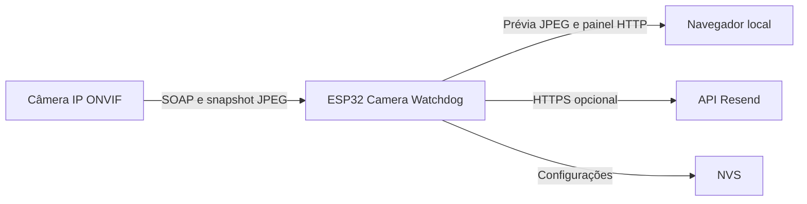

# ESP32 Camera Watchdog 0.11.0

Firmware para ESP32 que monitora uma câmera IP por ONVIF, valida snapshots JPEG e disponibiliza uma Prévia local no navegador. O watchdog também pode enviar alertas e executar uma recuperação controlada quando a câmera deixa de fornecer imagens válidas.

## Escopo da versão 0.11.0

A visualização da câmera é feita exclusivamente pela Prévia JPEG. O navegador nunca acessa a câmera diretamente: o ESP32 resolve o perfil ONVIF, autentica a solicitação, valida o JPEG e transfere o quadro ao painel.

O RTSP permanece somente como uma sonda básica de disponibilidade e como apoio opcional à descoberta da câmera. Ele não é usado para exibir imagens.

## Principais recursos

- descoberta por ONVIF WS-Discovery;
- varredura opcional e limitada da sub-rede;
- seleção automática de perfil ONVIF para snapshot;
- descoberta do serviço ONVIF PTZ e dos presets gravados na câmera;
- acionamento autenticado de posições PTZ e do preset Daemon;
- preferência configurável por nome de perfil JPEG;
- Prévia JPEG intermediada pelo ESP32;
- autenticação Basic e Digest nas solicitações à câmera;
- validação dos marcadores, tipo e tamanho da imagem;
- reaproveitamento de um quadro recente da Prévia como evidência de saúde;
- health-check periódico com estados de degradação, recuperação e indisponibilidade;
- reinicialização ONVIF manual ou automática com tolerância, cooldown e limite por janela;
- alertas por e-mail através da API HTTPS do Resend;
- configurações persistentes e validadas na NVS;
- painel responsivo com diagnóstico, recursos e histórico da sessão.

## Arquitetura



O acesso à câmera é serializado para evitar operações concorrentes entre Prévia, PTZ, health-check, descoberta e recuperação. As credenciais ONVIF permanecem no firmware e não são enviadas ao navegador.

## Requisitos

### Hardware e ambiente

- placa compatível com `esp32dev`;
- rede Wi-Fi de 2,4 GHz;
- PlatformIO;
- framework Arduino para ESP32;
- esquema de partições fornecido em `partitions.csv`.

### Câmera

- ONVIF Device Service;
- ONVIF Media1 com `GetProfiles` e `GetSnapshotUri`;
- endpoint HTTP que forneça snapshot JPEG;
- credenciais com permissão de consulta;
- `SystemReboot` disponível caso a recuperação por reinicialização seja utilizada.

## Configuração inicial

Crie o arquivo local de segredos a partir do modelo:

```text
include/secrets.example.h -> include/secrets.h
```

Preencha `include/secrets.h`:

```cpp
#pragma once

constexpr char WIFI_SSID[] = "NOME_DA_REDE";
constexpr char WIFI_PASSWORD[] = "SENHA_DA_REDE";

#define CAMERA_ONVIF_USERNAME_VALUE "usuario"
#define CAMERA_ONVIF_PASSWORD_VALUE "senha"

#define DASHBOARD_ADMIN_PASSWORD_VALUE "senha-administrativa"

constexpr char RESEND_API_KEY[] = "";
constexpr char RESEND_FROM[] = "Camera Watchdog <watchdog@example.com>";
constexpr char ALERT_EMAIL[] = "recipient@example.com";
```

Recomendações:

- mantenha `include/secrets.h` fora do controle de versão;
- não coloque credenciais em `main.cpp` ou `app_config.h`;
- configure uma senha administrativa se outras pessoas acessam a rede local;
- deixe `RESEND_API_KEY` vazio quando o envio de e-mails não for necessário.

Os filtros opcionais de fábrica ficam em `include/app_config.h`:

```cpp
constexpr char CAMERA_MATCH[] = "";
constexpr char CAMERA_IP_HINT[] = "";
constexpr char CAMERA_SNAPSHOT_PROFILE_MATCH[] = "snap";
```

## Compilar, gravar e monitorar

```bash
pio run
pio run -t upload
pio device monitor
```

O ambiente atual usa `platformio/espressif32@7.0.1`, placa `esp32dev` e framework Arduino. A porta de upload configurada em `platformio.ini` é `COM5` e pode precisar ser ajustada para o computador utilizado.

## Acessar o painel

Depois que o ESP32 se conectar à rede:

```text
http://IP_DO_ESP32/
http://camera-watchdog.local/
```

| Porta | Finalidade |
|---|---|
| 80/TCP | painel e API HTTP do ESP32 |
| 3702/UDP | WS-Discovery ONVIF na rede local |
| 554/TCP | sonda RTSP e auxílio à varredura, configurável |
| 443/TCP | API do Resend |

As portas ONVIF e do snapshot são determinadas a partir da câmera encontrada.

## Painel

### Câmera

Apresenta estado geral, endereço encontrado, sondas ONVIF e RTSP, último JPEG, contadores e atividade recente.

### Prévia

O navegador solicita `GET /api/camera/snapshot`. Para cada quadro, o firmware:

1. resolve os perfis e a URI de snapshot quando necessário;
2. prioriza um perfil JPEG compatível com o filtro configurado;
3. autentica a solicitação diretamente na câmera;
4. limita o tamanho da resposta;
5. confirma os marcadores JPEG `FF D8` e `FF D9`;
6. transfere o quadro ao navegador;
7. registra bytes, latência, falhas e cancelamentos.

`feedMinIntervalMs` limita a frequência máxima e `feedTargetCycleMs` define o ciclo desejado. O padrão é um quadro a cada cinco segundos; o limite configurável chega a dois quadros por segundo.

### Recursos

Exibe heap, maior bloco alocável, menor heap desde o boot, flash, PSRAM, Wi-Fi, catálogo ONVIF, relógio da câmera e eventos anunciados.

### Configurações

Permite ajustar identificação, perfil JPEG, monitoramento, recuperação, descoberta, notificações, timeouts, LED e ritmo do painel. O backend valida os limites e as relações entre campos antes de gravar a NVS.

### Ações

As posições PTZ detectadas ficam na aba Prévia, em uma lista pesquisável e rolável aberta por modal. O firmware mantém até 128 presets, portanto uma câmera com 50 posições não expande nem desorganiza a página. Os presets são atualizados automaticamente a cada minuto, e a Prévia é pausada durante a escolha e o comando para liberar o servidor HTTP e o canal da câmera.

A aba Ações permanece reservada ao health-check manual, redescoberta, reinicialização ONVIF da câmera, limpeza do limitador e reinicialização do ESP32. Operações mutáveis exigem o token de escrita da sessão e, quando configurada, a senha administrativa.

Os nomes personalizados exibidos pelo iCSee podem permanecer apenas no aplicativo. Quando a câmera publica nomes numéricos, o painel usa `Posição <token>`. Nesta câmera XM, o token `100` foi confirmado como o ponto Daemon e está definido por `CAMERA_DAEMON_PRESET_TOKEN` em `include/app_config.h`.

## Health-check

O ciclo de monitoramento:

1. verifica Wi-Fi e tolerância inicial;
2. aceita um JPEG recente da Prévia como evidência válida;
3. tenta reservar o canal de acesso à câmera;
4. consulta ONVIF e, se necessário, executa a sonda RTSP básica;
5. resolve, baixa e valida um snapshot JPEG;
6. separa falhas conclusivas de indisponibilidades temporárias de transporte;
7. aplica os limites de redescoberta, alerta, recuperação e estado offline.

Fontes possíveis em `healthEvidence.source`:

- `snapshot_jpeg`;
- `preview_jpeg`;
- `none`.

Incidentes possíveis:

- `snapshot_unavailable`: a câmera responde, mas não entrega JPEG válido após o limite configurado;
- `camera_offline`: controles e imagem deixaram de responder;
- `none`: nenhum incidente ativo.

## Recuperação automática

A reinicialização automática da câmera exige:

- opção habilitada;
- término da tolerância inicial;
- quantidade configurada de falhas JPEG conclusivas;
- endpoint ONVIF compatível com `SystemReboot`;
- ausência de erro permanente de configuração;
- inexistência de outro perfil de snapshot ainda pendente;
- cooldown e cota da janela disponíveis.

Erros 4xx, operação não suportada, URI inválida e snapshot HTTPS local não suportado não disparam reinicialização automática.

As últimas oito recuperações aceitas mantêm em RAM a evidência do snapshot, RSSI e heap. Esse histórico reinicia junto com o ESP32.

## Valores padrão

| Configuração | Valor |
|---|---:|
| Health-check | 15 s |
| Tolerância inicial | 90 s |
| Falhas para redescoberta | 2 |
| Falhas para offline | 3 |
| Sucessos para recuperação | 2 |
| Falhas JPEG para alerta | 2 |
| Falhas JPEG para reinicialização | 3 |
| Tolerância após reinicialização | 60 s |
| Cooldown de reinicialização | 5 min |
| Janela de reinicializações | 1 h |
| Máximo de reinicializações por janela | 3 |
| Timeout do snapshot | 5 s |
| Nova resolução da URI de snapshot | 15 s |
| Falhas antes de tentar outro perfil | 2 |
| Ciclo da Prévia | 5 s |
| Atualização do painel | 3 s |
| Varredura automática | ativa |
| Alertas por e-mail | ativos |

## Configurações persistentes

O firmware `0.11.0` usa o schema de configurações `3`:

- `GET /api/settings` lê valores, limites e token de escrita;
- `POST /api/settings` valida e salva alterações;
- `POST /api/settings/reset` apaga os valores atuais e restaura os padrões.

Registros persistidos com layout incompatível são removidos e substituídos pelos valores de fábrica. Depois de atualizar a partir de uma versão com outro schema, revise e salve novamente as configurações desejadas.

## API HTTP

| Método | Rota | Finalidade |
|---|---|---|
| GET | `/` | painel embarcado |
| GET | `/health` | disponibilidade do ESP32 |
| GET | `/api/status` | diagnóstico completo |
| GET | `/api/camera/snapshot` | quadro JPEG da Prévia |
| GET | `/api/settings` | configurações e token de escrita |
| POST | `/api/settings` | salvar configurações |
| POST | `/api/settings/reset` | restaurar padrões |
| POST | `/api/actions/health-check` | executar verificação |
| POST | `/api/actions/rediscover` | redescobrir a câmera |
| POST | `/api/actions/goto-ptz-preset` | mover a câmera para um preset PTZ detectado |
| POST | `/api/actions/reboot-camera` | reiniciar a câmera por ONVIF |
| POST | `/api/actions/reset-reboot-limiter` | limpar o limitador |
| POST | `/api/actions/reboot-esp32` | reiniciar o ESP32 |

## Diagnóstico

Campos úteis de `GET /api/status`:

- `state`, `lastEvent` e `uptimeSeconds`;
- `camera.known`, `ip`, `onvifUrl` e `rtspPort`;
- `probes.onvif*` e `probes.rtsp*`;
- `snapshot.healthy`, `status`, `latencyMs`, `bytesRead`, `profile` e `detail`;
- `snapshot.previewFetchOperations`, `busyResponses`, `clientAborts` e `bytesTransferred`;
- `healthEvidence.source` e `ageSeconds`;
- `onvif.services`, `onvif.ptz`, `deviceInfo`, `clock` e `events`;
- `recovery.automatic`, `manual`, `acceptedHistory` e `lastResult`;
- `resources.heap`, `flash`, `psram` e `bluetoothMemory`;
- `counters` e `settings`.

## Solução de problemas

### A Prévia não apresenta imagem

- confira `snapshot.ready`, `status` e `detail` em `/api/status`;
- confirme que o perfil escolhido oferece snapshot JPEG;
- verifique usuário e senha ONVIF;
- ajuste `snapshotProfileMatch` para outro perfil;
- aumente o timeout apenas se a câmera responder lentamente;
- consulte `busyResponses` para identificar contenção temporária.

### O ESP32 não encontra a câmera

- confirme que ESP32 e câmera estão na mesma rede;
- verifique se multicast UDP 3702 está permitido;
- preencha `CAMERA_IP_HINT` quando o WS-Discovery não for confiável;
- confira as portas candidatas em `ONVIF_PORT_CANDIDATES`;
- consulte `lastDiscovery` e `lastSubnetScan` no diagnóstico.

### A câmera não reinicia automaticamente

Confira `recovery.autoRebootEnabled`, `credentialsConfigured`, `attemptsInWindow`, `maxAttemptsInWindow`, `snapshot.conclusive`, `profileFailoverPending` e `recovery.lastResult`.

### Memória ou alimentação instável

- acompanhe `resources.heap.minimumFreeBytes` e `largestBlockBytes`;
- confira `resources.chip.resetReason`;
- compare RSSI, heap e horário dos erros;
- use fonte e cabo adequados aos picos de corrente do ESP32.

## Limitações

- uma câmera monitorada por ESP32;
- snapshot HTTPS local da câmera não suportado;
- painel HTTP sem TLS;
- histórico e contadores da sessão reiniciam no boot;
- varredura limitada a 254 hosts;
- Prévia dependente de `GetSnapshotUri` e de um JPEG válido.
- nomes personalizados do iCSee não são publicados por esta câmera via ONVIF;
- `GotoHomePosition` é aceito sem movimentar este modelo; o retorno Daemon usa o preset `100` confirmado no dispositivo.

## Segurança

- utilize o painel somente em uma rede local confiável;
- configure uma senha administrativa;
- não exponha a porta 80 diretamente à internet;
- mantenha `include/secrets.h` fora do repositório;
- trate `/api/status` como informação operacional sensível;
- limite o acesso ao ESP32 com regras de firewall quando necessário.

## Estrutura do projeto

```text
ESP32/
├── src/
│   └── main.cpp
├── include/
│   ├── app_config.h
│   ├── dashboard_page.h
│   ├── secrets.example.h
│   └── secrets.h
├── partitions.csv
├── platformio.ini
├── LICENSE
└── README.md
```

## Validação recomendada no dispositivo

1. confirme conexão Wi-Fi e endereço IP no monitor serial;
2. abra o painel por IP e mDNS;
3. confirme a descoberta ONVIF;
4. abra a Prévia e valide vários quadros consecutivos;
5. confira perfil, bytes e latência do JPEG;
6. salve configurações e confirme a persistência após reiniciar;
7. verifique que falhas inconclusivas não incrementam falhas JPEG conclusivas;
8. teste alertas e recuperação somente em ambiente controlado;
9. confirme cooldown e limite por janela;
10. acompanhe heap e RSSI durante uso prolongado.
11. confirme que o modal de posições PTZ aparece na aba Prévia, filtre a lista e teste o retorno ao ponto Daemon.

## Licença

MIT. Consulte `LICENSE`.
