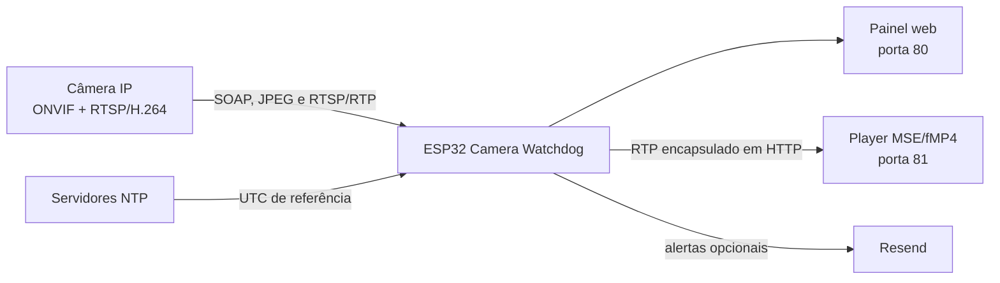

# ESP32 Camera Watchdog 0.8.5

Firmware para ESP32 que monitora uma câmera IP ONVIF/RTSP, oferece um painel web local, valida snapshots JPEG, retransmite vídeo H.264 para o navegador, controla PTZ e executa recuperação automática com limites de segurança.

A versão 0.8.5 concentra as correções de estabilidade e baixa latência do Ao Vivo. O navegador e o relay agora têm limites explícitos de backlog, encerrando uma sessão atrasada e reconectando em mídia atual. O firmware também compara o relógio UTC da câmera com uma referência SNTP obtida pelo próprio ESP32, sem confiar no relógio do computador ou do navegador.

## Funcionalidades

- descoberta da câmera por ONVIF WS-Discovery;
- varredura opcional da sub-rede quando a descoberta não encontra a câmera;
- catálogo dinâmico com `GetServices(true)` e validação dos endpoints anunciados;
- inventário de identificação, scopes, capacidades e tópicos de eventos ONVIF;
- seleção e failover de perfis JPEG;
- Prévia JPEG retransmitida sem manter a imagem inteira na RAM;
- Ao Vivo H.264 por RTSP/RTP sobre TCP, ESP32 e MSE/fMP4 no navegador;
- proteção contra acúmulo de vídeo antigo no relay e no navegador;
- controle PTZ de pan, tilt e zoom na tela Ao Vivo;
- solicitação best-effort de quadro-chave com `SetSynchronizationPoint`;
- health-check com evidências independentes de JPEG e RTP;
- recuperação automática por `ONVIF SystemReboot`, com graça, cooldown e janela móvel;
- alertas por e-mail usando Resend;
- LED local de estado no GPIO 2;
- configurações persistidas na NVS;
- diagnóstico JSON detalhado de câmera, rede, memória, relay, relógio e recuperação.

## Arquitetura



O relay integrado atende um navegador por vez. O canal de acesso à câmera é serializado para impedir que Prévia, health-check, PTZ e relay corrompam a mesma sessão de rede.

## Principais mudanças da 0.8.5

### Latência do Ao Vivo

- o player inicia com aproximadamente 1,5 s de mídia acumulada;
- fragmentos MSE são agrupados em lotes limitados a 0,5 s, 12 entradas ou 512 KiB;
- uma fila JavaScript acima de 6 s gera `LiveBacklogError` e reconecta em uma sessão nova;
- o player nunca descarta P-frames ou fragmentos FU-A isoladamente para tentar alcançar o tempo real;
- o watchdog acompanha `video.currentTime`; oito segundos sem progresso acionam recuperação e, se necessário, reconexão;
- a interface mostra a latência estimada no navegador, incluindo mídia ainda não anexada ao `SourceBuffer`.

### Proteção no relay

- cada registro enviado ao navegador possui deadline total de 1 s;
- a escrita usa socket não bloqueante, evitando que um cliente lento retenha indefinidamente o RTP da câmera;
- o relay compara o avanço do timestamp RTP com o tempo monotônico;
- atraso RTP acima de 3 s em duas janelas consecutivas encerra a sessão e força reconexão fresca;
- pacotes duplicados ou atrasados não alimentam o detector de drift;
- RTP v2, payload type, extensão, padding e H.264 são validados antes da retransmissão;
- NAL simples, STAP-A, STAP-B, FU-A e FU-B são aceitos; formatos não suportados são contabilizados como inválidos;
- abortos por latência têm telemetria própria e não contam como falha da câmera, incidente, LED ou gatilho de reboot.

### Relógio da câmera

- o ESP32 registra quando recebeu uma sincronização SNTP nesta inicialização;
- `GetSystemDateAndTime` é executado periodicamente, fora do inventário ONVIF inicial;
- o desvio é calculado entre `UTCDateTime` da câmera e o ponto médio da consulta usando a referência SNTP do ESP32;
- alterações da referência SNTP durante a consulta invalidam a amostra;
- o painel mostra modo, timezone reportado, desvio e validade da referência;
- a verificação é somente leitura: o firmware não muda automaticamente NTP para Manual e não envia `SetSystemDateAndTime`;
- datas humanas no painel usam automaticamente o timezone do navegador; o JSON e o WS-Security continuam em UTC.

NTP fornece UTC, mas não determina o timezone geográfico da câmera. O timezone do OSD continua sendo configuração da própria câmera.

## Requisitos

### ESP32

- placa compatível com o ambiente PlatformIO `esp32dev`;
- flash de 4 MB usando `partitions.csv`;
- Wi-Fi de 2,4 GHz;
- PSRAM não é obrigatória.

### Câmera

- acesso pela mesma rede local do ESP32;
- serviço ONVIF Device Management;
- Media1 com perfis e `GetSnapshotUri` para a Prévia;
- RTSP H.264 para o Ao Vivo;
- RTP sobre RTSP/TCP para o relay integrado;
- serviço PTZ ONVIF para pan, tilt e zoom;
- `SystemReboot` apenas se a recuperação automática for utilizada.

O player integrado aceita H.264. H.265/HEVC e áudio não são reproduzidos.

## Configuração inicial

Crie o arquivo local de segredos a partir do exemplo:

```powershell
Copy-Item include\secrets.example.h include\secrets.h
```

Preencha `include/secrets.h`:

```cpp
#pragma once

constexpr char WIFI_SSID[] = "NOME_DA_REDE";
constexpr char WIFI_PASSWORD[] = "SENHA_DA_REDE";

#define CAMERA_ONVIF_USERNAME_VALUE "usuario"
#define CAMERA_ONVIF_PASSWORD_VALUE "senha"

#define CAMERA_RTSP_USERNAME_VALUE CAMERA_ONVIF_USERNAME_VALUE
#define CAMERA_RTSP_PASSWORD_VALUE CAMERA_ONVIF_PASSWORD_VALUE

#define DASHBOARD_ADMIN_PASSWORD_VALUE "senha-administrativa"

constexpr char RESEND_API_KEY[] = "";
constexpr char RESEND_FROM[] = "Camera Watchdog <watchdog@example.com>";
constexpr char ALERT_EMAIL[] = "recipient@example.com";
```

Regras:

- não versione nem compartilhe `include/secrets.h`;
- credenciais ONVIF podem ficar vazias quando a câmera não exige autenticação;
- credenciais RTSP reutilizam ONVIF por padrão, mas podem ser diferentes;
- Resend é opcional; sem chave válida, somente o envio de e-mail fica indisponível;
- configure `DASHBOARD_ADMIN_PASSWORD_VALUE` para proteger ações sensíveis.

## Compilar, gravar e monitorar

O ambiente atual está em `platformio.ini`:

```ini
[env:esp32dev]
platform = platformio/espressif32@7.0.1
board = esp32dev
framework = arduino
monitor_speed = 115200
upload_speed = 460800
board_build.partitions = partitions.csv
```

Comandos básicos:

```powershell
pio run
pio run --target upload
pio device monitor
```

Para selecionar explicitamente a COM5:

```powershell
pio run --target upload --upload-port COM5
pio device monitor --port COM5 --baud 115200
```

Também podem ser usadas as tarefas Build, Upload e Monitor da extensão PlatformIO.

## Acesso ao painel

Depois da conexão Wi-Fi, abra:

```text
http://camera-watchdog.local
```

Se o mDNS não estiver disponível, use o IP informado no monitor serial.

| Porta | Uso |
|---:|---|
| 80/TCP | painel e API HTTP |
| 81/TCP | relay HTTP/RTP do Ao Vivo |
| 3702/UDP | WS-Discovery ONVIF |
| 554/TCP | RTSP da câmera por padrão |

O player abre uma URL semelhante a:

```text
http://IP_DO_ESP32:81/stream?profile=1
```

## Módulos do painel

### Câmera

Apresenta estado global, disponibilidade, resultados das sondas, incidentes, última evidência de saúde, recuperação e diagnóstico bruto.

### Prévia

A Prévia executa um GET HTTP no snapshot da câmera e retransmite o JPEG conforme os bytes chegam:

- o perfil e a URI ONVIF são mantidos em cache e não são resolvidos a cada quadro;
- o JPEG completo não é armazenado na RAM;
- o buffer de retransmissão possui 2 KiB;
- o padrão é um quadro a cada 5 s, no máximo 0,2 FPS;
- a Prévia para ao sair da tela ou ocultar a aba;
- um quadro completamente entregue pode ser reutilizado como evidência do health-check;
- fechamento do navegador incrementa `clientAborts`, não `snapshot.errors`.

### Ao Vivo

Fluxo do vídeo:

1. o firmware obtém o URI RTSP do perfil H.264 selecionado;
2. abre `DESCRIBE`, `SETUP` interleaved e `PLAY`;
3. valida os pacotes RTP/H.264;
4. encapsula cada pacote em um registro HTTP binário;
5. o navegador reconstrói os access units e gera fMP4 para MSE;
6. watchdogs de progresso, fila e drift encerram sessões atrasadas.

Se nenhum IDR chegar nos primeiros 750 ms, o relay tenta `SetSynchronizationPoint`. A falha desse comando é best-effort e não encerra a sessão.

O player alterna para outro perfil H.264 quando uma tentativa não chega à reprodução real. Receber apenas SDP ou bitrate não é considerado sucesso suficiente.

### Controle PTZ

Quando a câmera anuncia serviço PTZ:

- botões pressionados enviam `ContinuousMove`;
- soltar envia `Stop`;
- velocidade é ajustável entre 10% e 100%;
- a câmera recebe timeout de segurança de 2 s para o movimento;
- ocultar a aba ou sair do Ao Vivo também tenta enviar `Stop`;
- comandos exigem `writeToken` e, quando configurada, senha administrativa.

### Recursos

Mostra heap, maior bloco, mínimo histórico, PSRAM, flash, Wi-Fi, catálogo ONVIF, eventos anunciados, sincronização de quadro-chave e relógio da câmera.

O card do relógio usa a referência SNTP do ESP32. Se o OSD da câmera e o relógio do computador divergirem, consulte `onvif.clock` antes de concluir que o vídeo está atrasado.

### Configurações e Ações

Configurações são validadas pelo firmware e persistidas na NVS. Ações manuais permitem executar health-check, redescobrir a câmera, solicitar reboot ONVIF, limpar o limitador e reiniciar o ESP32.

## Como o health-check decide o estado

O monitor combina várias evidências, em vez de depender apenas do snapshot:

1. novo RTP entregue pelo relay;
2. relay ativo ou período curto de graça após uma sessão;
3. JPEG completo entregue recentemente pela Prévia;
4. disponibilidade ONVIF e RTSP;
5. resolução e validação do snapshot JPEG;
6. canário `DESCRIBE`/`SETUP`/`PLAY` com primeiro RTP nos perfis H.264 compatíveis.

Fontes positivas aparecem em `healthEvidence.source`:

- `relay_rtp`;
- `preview_jpeg`;
- `snapshot_jpeg`;
- `media_canary_rtp`.

Ciclos inconclusivos, mutex ocupado, autenticação inválida, HTTP 4xx ou transporte não suportado não comprovam falha de mídia e não autorizam reboot.

Incidentes possíveis:

- `snapshot_unavailable`: controles respondem, mas JPEG e canário de mídia falharam de forma conclusiva;
- `camera_offline`: a câmera não responde aos controles e não existe evidência recente de imagem.

O LED pisca por incidente confirmado, câmera offline, recuperação, perda de Wi-Fi ou outra condição global real. Uma reconexão de baixa latência do relay não é incidente.

## Recuperação automática

O comando utilizado é:

```text
ONVIF Device Management / SystemReboot
```

Um reboot automático exige, em conjunto:

- ONVIF ainda acessível;
- falha JPEG conclusiva;
- ausência de RTP recente no relay;
- varreduras completas sem RTP em todos os perfis H.264 compatíveis;
- limiar de falhas consecutivas;
- fim da graça inicial e da graça pós-reboot;
- cooldown e cota da janela ainda disponíveis.

Regras de segurança:

- falha isolada do snapshot não autoriza reboot;
- somente comandos aceitos consomem a cota da janela móvel;
- um reboot aceito zera sequências conclusivas e inicia graça silenciosa;
- autenticação, configuração inválida e recurso não suportado são inconclusivos para ação destrutiva;
- aborto por latência do Ao Vivo não incrementa `failedSessions` nem contadores do health-check.

O ESP32 não corta a energia da câmera. Se ela perder toda a conectividade, `SystemReboot` não pode ser entregue; esse cenário exige relé, MOSFET ou tomada inteligente externa.

## Valores padrão

| Configuração | Padrão |
|---|---:|
| Intervalo do health-check | 15 s |
| Graça inicial | 90 s |
| Falhas para redescoberta | 2 |
| Falhas para declarar offline | 3 |
| Sucessos para confirmar recuperação | 2 |
| Falhas de vídeo para alerta | 2 |
| Falhas de vídeo para reboot | 3 |
| Graça após reboot | 60 s |
| Cooldown entre reboots | 5 min |
| Janela móvel de reboots | 1 h |
| Máximo de reboots aceitos na janela | 12 |
| Timeout genérico ONVIF/RTSP | 3 s |
| Timeout HTTP do snapshot | 5 s |
| Retry de resolução do snapshot | 15 s |
| Ciclo da Prévia | 5 s, até 0,2 FPS |
| Atualização do painel | 3 s |
| Evidência recente de RTP | 30 s |
| Reuso do canário RTP | 60 s |
| Timeout de pacote do Ao Vivo | 12 s |
| Buffer inicial do player | 1,5 s |
| Limite da fila MSE | 6 s |
| Deadline de escrita do relay | 1 s |
| Drift RTP que força reconexão | 3 s em 2 janelas |
| Timeout de segurança PTZ | 2 s |
| Verificação periódica do relógio | 15 min |
| Retry de relógio inconclusivo | 60 s |

Esses valores podem ser alterados pelo painel quando pertencem a `RuntimeSettings`. Limites internos do player, relay, PTZ e observação do relógio permanecem definidos no firmware.

## Configurações e NVS

- namespace: `camcfg`;
- chave principal: `runtime`;
- chave da revisão: `defaults_rev`;
- schema: `1`;
- revisão dos defaults: `2`.

Na migração para a revisão 2, intervalos da Prévia ainda iguais aos defaults antigos são atualizados para 5 s. Valores personalizados são preservados.

Restaurar padrões limpa a configuração persistida e reaplica os valores de `include/app_config.h`.

## API HTTP

| Método | Endpoint | Função |
|---|---|---|
| GET | `/` | painel web |
| GET | `/health` | resposta simples `ok` |
| GET | `/api/status` | diagnóstico completo |
| GET | `/api/camera/snapshot` | JPEG validado e retransmitido |
| POST | `/api/camera/ptz` | `ContinuousMove` ou `Stop` |
| GET | `/api/settings` | valores, limites e token temporário de escrita |
| POST | `/api/settings` | valida e grava configurações na NVS |
| POST | `/api/settings/reset` | restaura padrões |
| POST | `/api/actions/health-check` | agenda verificação manual |
| POST | `/api/actions/rediscover` | agenda redescoberta ONVIF |
| POST | `/api/actions/reboot-camera` | solicita `SystemReboot` |
| POST | `/api/actions/reset-reboot-limiter` | limpa cooldown e janela |
| POST | `/api/actions/reboot-esp32` | reinicia o ESP32 |
| GET | `/assets/live-player.js` | player JavaScript embarcado |

Operações de escrita exigem o `writeToken` fornecido por `/api/settings`. Quando `DASHBOARD_ADMIN_PASSWORD_VALUE` não está vazio, a senha administrativa também é obrigatória.

## Diagnóstico `/api/status`

Campos importantes:

- `firmwareVersion`, `state`, `lastEvent` e `uptimeSeconds`;
- `resources.heap`, `resources.psram`, `resources.flash` e `resources.chip.resetReason`;
- `wifi.connected`, `wifi.rssi`, IP e gateway;
- `onvif.services`, `onvif.capabilities`, `onvif.deviceInfo` e `onvif.events`;
- `onvif.clock.referenceSynchronized`, `healthy`, `driftMilliseconds`, `dateTimeType` e `reportedTimeZone`;
- `onvif.ptzControl.attempts`, `accepted`, `errors` e `lastResult`;
- `snapshot.healthy`, `conclusive`, `served`, `clientAborts`, `cameraHttpRequests` e `healthEvidenceUses`;
- `healthEvidence.source` e `healthEvidence.ageSeconds`;
- `mediaCanary.playAccepted`, `mediaReceived`, `profilesTested` e `observedAfterPlayMs`;
- `live.relay.mediaActive`, `currentSessionPackets`, `currentSessionBytes` e `lastMediaPacketAgeSeconds`;
- `live.relay.currentRtpClockDriftMs`, `slowWriteCount`, `writeDeadlineExceeded` e `latencyAborts`;
- `live.relay.lastLatencyAbortReason`, `invalidRtpPackets`, `syncAccepted`, `syncFailed` e `syncSkipped`;
- `incident.kind`, `incident.durationSeconds` e estado do alerta;
- `recovery.graceActive`, `attemptsInWindow`, limites e último resultado;
- contadores de verificações bem-sucedidas, falhas e inconclusivas.

Exemplo reduzido:

```json
{
  "firmwareVersion": "0.8.5",
  "state": "online",
  "onvif": {
    "clock": {
      "referenceSynchronized": true,
      "utcValid": true,
      "healthy": true,
      "driftMilliseconds": -620,
      "dateTimeType": "NTP",
      "reportedTimeZone": "BRT3"
    }
  },
  "snapshot": {
    "healthy": true,
    "clientAborts": 0
  },
  "live": {
    "relay": {
      "mediaActive": true,
      "currentRtpClockDriftMs": 140,
      "latencyAborts": 0
    }
  }
}
```

`driftMilliseconds` e `roundTripMs` são `null` quando a amostra do relógio é inconclusiva.

### Motivo do reset

| `resetReason` | Indicação |
|---|---|
| `power_on` | energização normal |
| `software` | reinicialização solicitada pelo firmware |
| `brownout` | queda ou instabilidade de alimentação |
| `task_watchdog` / `interrupt_watchdog` | tarefa ou interrupção bloqueada |
| `panic` | exceção ou falha de execução |

## Solução de problemas

### O OSD parece dezenas de segundos atrasado

1. consulte `onvif.clock.referenceSynchronized`;
2. confira `onvif.clock.driftMilliseconds`;
3. se a câmera estiver alinhada ao ESP32, sincronize o relógio do computador ou celular;
4. não use somente o relógio da barra de tarefas para medir latência do vídeo;
5. use os indicadores `Latência no navegador` e `Atraso no relay` da tela Ao Vivo.

### O Ao Vivo mostra bitrate, mas a imagem congela

1. confira FPS e latência no navegador;
2. consulte `pendingLatencySeconds`, `mseLatencySeconds` e `liveLatencySeconds` no callback do player durante depuração;
3. confira `currentRtpClockDriftMs`, `slowWriteCount` e `latencyAborts` no status;
4. confirme se o player reconecta quando a fila ultrapassa 6 s;
5. verifique `invalidRtpPackets` e `lastError`.

### O Ao Vivo entra em reconexão contínua

- verifique sinal Wi-Fi, `maxWriteDurationMs` e `writeDeadlineExceeded`;
- confirme que o navegador alcança a porta 81 diretamente;
- teste outro perfil H.264;
- procure limite de sessões simultâneas na câmera, especialmente se o iCSee também estiver aberto;
- encerre outras conexões RTSP antes de concluir que o perfil está defeituoso.

### A Prévia não mostra imagem

- confira `snapshot.profile`, `targetResolved`, `status` e `detail`;
- verifique `busyResponses` para identificar contenção com o Ao Vivo;
- confira `cameraHttpRequests`, `previewFetchOperations` e `clientAborts`;
- aguarde o failover de perfil antes de reiniciar a câmera.

### A câmera não reinicia automaticamente

- confirme que ONVIF ainda responde;
- verifique credenciais e o resultado de `SystemReboot`;
- confira graça, cooldown, janela e cota;
- valide que todos os perfis H.264 falharam de forma conclusiva;
- se a câmera estiver totalmente fora da rede, use power-cycle externo.

### Suspeita de alimentação ou travamento do ESP32

- consulte `resources.chip.resetReason`;
- acompanhe `minimumFreeBytes` e `largestBlockBytes`;
- procure `brownout`, `watchdog` ou `panic`;
- verifique fonte, cabos, regulador e aterramento.

## Limitações atuais

- apenas H.264 é reproduzido no navegador;
- áudio não é retransmitido;
- somente um navegador usa o relay por vez;
- eventos ONVIF são inventariados por `GetEventProperties`, mas ainda não existe assinatura PullPoint em runtime;
- Media2 é catalogado, porém os fluxos atuais usam Media1;
- o firmware observa o relógio da câmera, mas não o corrige automaticamente;
- não existe power-cycle físico da câmera;
- o painel e o relay usam HTTP sem TLS.

## Segurança

O projeto foi projetado para uma LAN confiável. Não exponha as portas 80, 81 ou ONVIF diretamente à internet.

- painel e API não usam TLS;
- o relay da porta 81 não possui autenticação HTTP própria;
- o cliente HTTPS do Resend está configurado com `setInsecure()`;
- o token de escrita é entregue pelo endpoint local `/api/settings` e deve permanecer restrito à LAN confiável;
- credenciais permanecem compiladas em `include/secrets.h`;
- câmeras que aceitam comandos ONVIF sem autenticação devem ficar isoladas por firewall ou VLAN.

Use senha administrativa, rede segmentada e regras de firewall em instalações sensíveis.

## Estrutura do projeto

```text
ESP32/
├── src/
│   ├── main.cpp                  # estado, ONVIF, snapshot, API e recuperação
│   └── live_stream_relay.cpp     # RTSP/RTP e relay de baixa latência
├── include/
│   ├── app_config.h              # defaults e limites
│   ├── dashboard_page.h          # painel web embarcado
│   ├── live_catalog.h            # perfis ONVIF e status do relay
│   ├── live_player.js            # fonte JavaScript do player
│   ├── live_player_script.h      # cópia do player em PROGMEM
│   ├── live_stream_relay.h       # contratos públicos do relay
│   ├── secrets.example.h         # exemplo de configuração privada
│   └── secrets.h                 # configuração local ignorada pelo Git
├── partitions.csv
├── platformio.ini
├── LICENSE
└── README.md
```

`include/live_player.js` e o conteúdo JavaScript de `include/live_player_script.h` devem permanecer idênticos.

## Validação recomendada

1. compile o ambiente `esp32dev`;
2. grave o firmware e abra o monitor em 115200 baud;
3. confirme `firmwareVersion: 0.8.5` em `/api/status`;
4. valide heap, maior bloco e motivo do reset;
5. confirme catálogo ONVIF e perfis H.264/JPEG;
6. abra a Prévia e confirme JPEG válido a cada 5 s;
7. abra o Ao Vivo e confirme FPS, bitrate e latência limitada;
8. mantenha o vídeo aberto por pelo menos 30 minutos e confirme que o atraso não cresce continuamente;
9. confira `latencyAborts`, `writeDeadlineExceeded` e `invalidRtpPackets`;
10. valide pan, tilt, zoom e parada ao soltar;
11. oculte a aba durante movimento e confirme a parada de segurança;
12. confirme `onvif.clock.referenceSynchronized: true` e um drift saudável;
13. teste falha de snapshot mantendo RTSP disponível e confirme ausência de reboot falso;
14. valide graça, cooldown e janela antes de testar `SystemReboot`;
15. confirme que abortos do navegador e reconexões por latência não acionam LED ou incidente.

## Licença

Distribuído sob a licença MIT. Consulte [LICENSE](LICENSE).
